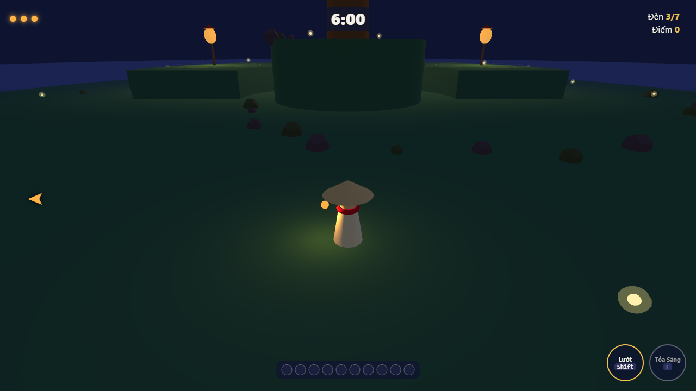
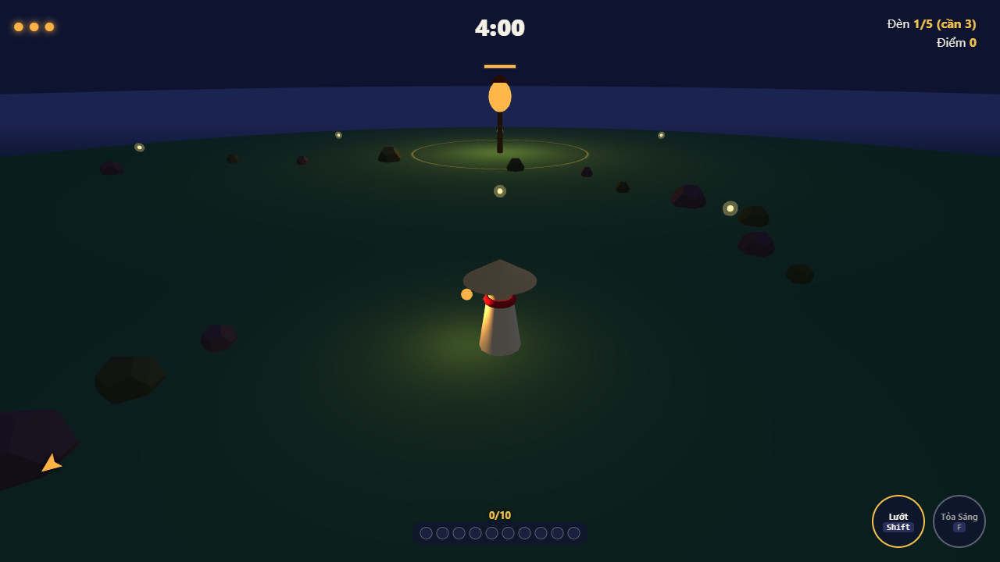
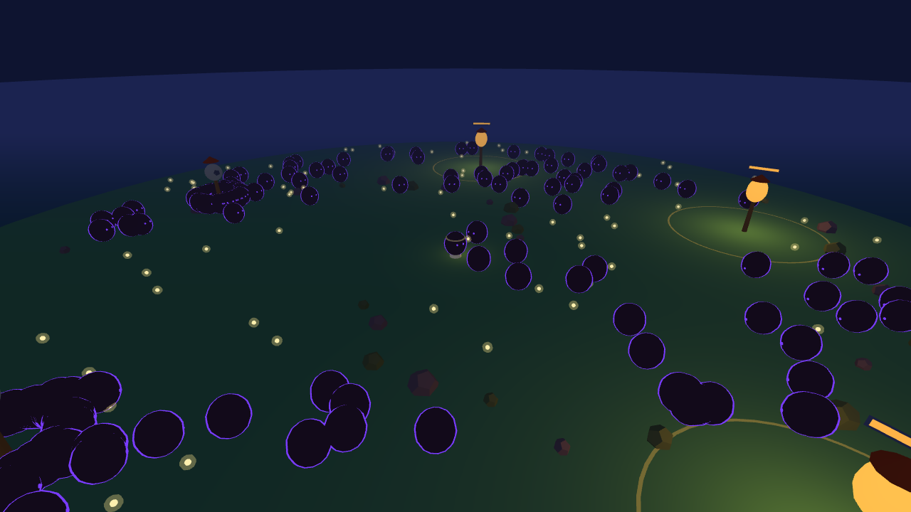

# Đảo Đèn Lồng — v1.0.0

> **Video demo:** _[docs/demo/demo.mp4](docs/demo/demo.mp4) / đính kèm Release [v1.0.0](../../releases/tag/v1.0.0)_
> Tô Minh Thành · MSSV 2A202603439 · Day 12 AI SDLC Lab (K5-L3A)

Game 3D góc nhìn thứ ba. **Mây**, người giữ đèn nhỏ tuổi đội nón lá, gom **đom đóm** để thắp và **giữ cho các Đèn Lồng Lớn sáng tới bình minh** trên ba hòn đảo (Đảo Bến, Đảo Cau, Đảo Chuông). Mây phải **tỏa sáng** để xua **Bóng Mực** (chúng hút dầu đèn) và giữ đom đóm khỏi tay **Gió Lạc**.



| | |
|---|---|
|  |  |

- Game chạy trên trình duyệt (Three.js r160 / WebGL2), logic là JavaScript thuần trong `src/core/`. Cùng một mã nguồn được dùng cho bản có giao diện, chế độ **headless**, **benchmark** và **soak** (Test Contract **v1.3**).
- Tài liệu gốc của lab: [docs/lab/](docs/lab/README.md).

## Yêu cầu hệ thống

- **Node.js ≥ 20** (đã thử với 22) và npm. Chạy được trên macOS, Linux, Windows.
- Trình duyệt có WebGL2: Chrome, Edge, Firefox hoặc Safari bản mới.
- Riêng **benchmark** cần Google Chrome hoặc Chromium. Script tự tìm ở đường dẫn mặc định; nếu không thấy thì đặt `CHROME=/đường/dẫn/chrome`.
- Không cần GPU rời. Đo trên Intel UHD (laptop) đạt khoảng 270 FPS ở cảnh benchmark.

## Cài đặt và chạy (3 lệnh)

```bash
git clone <repo-url> && cd <repo>
npm install
npm start          # rồi mở http://localhost:8080/
```

**Bản phát hành không cần Node:** tải `dao-den-long-v1.0.0-web.zip` ở [Release v1.0.0](../../releases/tag/v1.0.0), giải nén, rồi trong thư mục đó chạy `python3 -m http.server 8080` và mở http://localhost:8080/. Bản này có sẵn Three.js; bảng xếp hạng lưu trong trình duyệt.

## Điều khiển (đổi được trong Cài đặt)

| Mặc định | Hành động |
|---|---|
| `W` `A` `S` `D` | Đi (theo hướng camera) |
| Kéo chuột / `←` `→` | Xoay camera |
| `Space` | Nhảy |
| `Shift` | Lướt (14 m/s trong 0.2 s, hồi 1.5 s) |
| `E` | Tương tác: thắp đèn tắt / châm dầu đèn đang sáng (trong 2 m) |
| `F` | Tỏa Sáng (tốn 3 đom đóm, bán kính 5 m, hồi 3 s) |
| `P` / `Esc` | Tạm dừng: Tiếp tục / Chơi lại Đêm / Cài đặt / Về menu |
| `F3` | Hiện FPS |

**Cài đặt** (được lưu lại):
- Âm lượng, độ nhạy chuột.
- **Đổi mọi phím**: báo khi trùng phím, có nút "Khôi phục mặc định".
- **Bảng màu dễ phân biệt** (mù màu).
- **Giảm chuyển động**: tắt rung camera và chớp màn hình.
- **Chữ lớn ×1.25** (chữ mặc định ≥ 18 px).
- **Phụ đề / chỉ báo hình ảnh** khi: Bóng Mực xuất hiện (kèm mũi tên ở mép màn hình), gió sắp thổi, 10 giây cuối, đèn sắp cạn dầu.

## Luật chơi

- **Ba Đêm:** Đảo Bến (5 đèn, 240 s), Đảo Cau (6 đèn, 270 s, 2 đảo nối bằng cầu tre, bục nhảy), Đảo Chuông (7 đèn, 300 s, 3 tầng, dốc, bục, gió mạnh).
- **Mục tiêu:** khi trời sáng, Mây còn sống và **≥ 60% số đèn đang sáng** (3/5, 4/6, 5/7). Thắp hết đèn không kết thúc Đêm. Thua khi hết 3 Ngọn Lửa, hoặc trời sáng mà không đủ đèn.
- **Dầu đèn:**
  - Đèn vừa thắp có 100 dầu, hao 1/giây; hết dầu thì tắt.
  - Thắp lần đầu cần 10 đom đóm, thắp lại chỉ cần 5.
  - `E` ở đèn đang sáng để châm dầu (+10 dầu mỗi đom đóm).
  - Dưới 30 dầu: đèn nhấp nháy, mất vùng an toàn 6 m, và Bóng Mực tới **hút dầu** (5/giây).
- **Đom đóm:** tự nhặt khi ≤ 1 m. Sức chứa 10, mỗi lần thắp thành công +2 (tối đa 20).
- **Bóng Mực:** đuổi trong 12 m, bỏ đuổi khi xa hơn 18 m. Bị chạm thì Mây mất 1 Ngọn Lửa, rơi một nửa số đom đóm, rồi bất tử 1.5 s.
- **Gió Lạc:** cướp tối đa 3 đom đóm.
- **Bùa Gió:** chạy 7.2 m/s và lướt không hồi chiêu trong 10 s.
- **Rơi khỏi đảo:** mất 1 Ngọn Lửa và toàn bộ đom đóm.

| Điểm | |
|---|---|
| Mỗi đom đóm nạp vào đèn (thắp, thắp lại, châm dầu) | +5 |
| Thắp lần đầu / thắp lại | +100 / +40 |
| Bóng Mực trúng Tỏa Sáng | +5 (+15 nếu nó đang hút dầu) |
| Bình minh (khi thắng): mỗi đèn đang sáng | +50 + phần nguyên của dầu |
| Bình minh (khi thắng): mỗi Ngọn Lửa còn lại | +50 |

Tổng điểm = tổng điểm các Đêm đã thắng. Sau màn **Bình Minh** (thắng Đêm 3) hoặc sau khi thua, người chơi nhập tên để lưu vào **Bảng xếp hạng** (top 10, mở được từ menu chính).

## Kiểm thử, headless, benchmark, soak

```bash
npm test                     # 85 test: unit, contract v1.3, bảng màu, bảng xếp hạng, soak, cảnh bench, 58 scenario headless
npm run proof                # sinh lại bằng chứng headless vào docs/proof/phase-4/ (scenario + tất định + thời gian)

# headless (Test Contract): nối thêm tham số vào headless_cmd
node src/headless.js --seed 1 --night 2 --ticks 3600 --out out.jsonl [--scenario s.json] [--inputs i.json] [--snapshot-every 10]

# benchmark (Ticket-04 §1) — mở Chrome 1280×720, tắt vsync, tự thoát sau 3 s khởi động + 30 s đo
node tools/bench.js --seed 42 --duration 30 --out bench.json

# soak (Ticket-04 §2) — 10 Đêm liên tiếp trong một tiến trình
node --expose-gc --jitless --no-expose-wasm tools/soak.js --seed 7 --nights 10 --out soak.json

# bảng xếp hạng
node tools/serve.js --export-leaderboard out.json

# kiểm tra giao diện qua Chrome thật (cần `npm start` chạy sẵn)
node tools/ui-smoke.js          # 23 bước: menu, tạm dừng, cài đặt, mù màu, đổi phím, chữ lớn, phụ đề, bảng xếp hạng
npm run build                   # dist/dao-den-long-v1.0.0-web.zip (asset của Release)
```

**Kết quả trên máy của tôi** (Windows 11, i5-12450H, Intel UHD, 16 GB). Máy chấm sẽ đo lại:

| | Kết quả | Ngưỡng |
|---|---|---|
| [bench.json](bench.json) | avg 270.6 FPS · p1-low 134.8 FPS · p95 5.5 ms · load 640 ms · RSS đỉnh 806 MB (cả cây tiến trình Chrome) | ≥ 60 · ≥ 30 · ≤ 10 000 ms |
| [soak.json](soak.json) | 10 Đêm, 0 crash, RSS 27.5 → 31.2 MB (×1.13) | 0 crash, ≤ ×1.2 |

- **Benchmark:** vsync được tắt bằng cờ Chrome `--disable-gpu-vsync --disable-frame-rate-limit`. `peak_mem_mb` là RSS cộng dồn của trình duyệt, GPU và renderer.
- **Soak:** chạy với `--jitless` vì khi bật JIT, phần code V8 biên dịch làm RSS tăng ×1.41 trong 10 Đêm đầu rồi đứng yên (40 Đêm: ×1.32). Đây không phải rò rỉ; số đo đầy đủ ở [docs/notes/phase-4.md](docs/notes/phase-4.md#soak).

## Test Contract v1.3

`game.contract.json` có `build_cmd`, `run_cmd`, `headless_cmd`, `bench_cmd`, `soak_cmd`. `tuning` lấy từ [src/core/tuning.js](src/core/tuning.js), và có test bảo đảm hai nơi trùng nhau. Ghi chú:

- Đêm 3 xuất phát tại (0,0,−30), vì (0,0,0) nằm trong tháp chuông.
- Trạng thái Bóng Mực: `spawning` / `wander` / `chase` / `recoil` / `stunned` / `drain`. Lý do kết thúc: `dawn_survived` / `dawn` / `no_flames`.
- Mã thoát: `0` ok · `1` tham số sai / lỗi khác · `2` file inputs/scenario sai định dạng.

## Sáng tạo của tôi

Tất cả chỉ nằm trong `web/` (phần hiển thị). `src/core/` không import `web/`, nên phần này không thể đổi đầu ra headless. Cảnh benchmark cũng không có các phần thêm này: Mây không mang đom đóm, không có nhạc, không có gió.

1. **Lời dẫn tự viết cho Ông Đăng** ở màn giới thiệu từng Đêm và màn Bình Minh.
2. **Đom đóm bay quanh nón** Mây, đúng bằng số đang mang.
3. **Âm thanh tự tổng hợp bằng WebAudio** (không dùng file): nhạc đêm ngũ cung, chuông thắp đèn, gió.
4. **Hiệu ứng nhỏ:** Bóng Mực phồng lên khi xuất hiện, lắc khi bị choáng; Gió Lạc là dải lụa uốn lượn; trời hồng ở màn Bình Minh.
5. **Đèn tắt có vết rách giấy**, đi kèm chế độ mù màu, nên trạng thái đèn đọc được không cần màu.

Bằng chứng phần lõi vẫn đúng: [docs/proof/phase-3/RESULTS.md](docs/proof/phase-3/RESULTS.md) (61/61) và `npm test` (85/85).

## Tài liệu, bằng chứng, harness

| Phase | Ghi chép | Bằng chứng |
|---|---|---|
| 1 (PRD-0) | [phase-1.md](docs/notes/phase-1.md) | [proof/phase-1](docs/proof/phase-1/RESULTS.md) |
| 2 (Ticket-02) | [phase-2.md](docs/notes/phase-2.md) | [proof/phase-2](docs/proof/phase-2/RESULTS.md) · [ảnh](docs/proof/phase-2/screens/) · [FPS](docs/proof/phase-2/fps.json) · [UI](docs/proof/phase-2/ui-smoke.txt) |
| 3 (Ticket-03) | [phase-3.md](docs/notes/phase-3.md) · [ADR 0001](docs/adr/0001-lantern-fuel-and-dawn-win.md) | [proof/phase-3](docs/proof/phase-3/RESULTS.md) · [test cũ trước khi sửa](docs/proof/phase-3/old-tests-before-update.txt) · [ảnh](docs/proof/phase-3/screens/) · [UI](docs/proof/phase-3/ui-smoke.txt) |
| 4 (Ticket-04) | [phase-4.md](docs/notes/phase-4.md) | [proof/phase-4 (61/61 hồi quy)](docs/proof/phase-4/RESULTS.md) · [bench.json](bench.json) · [soak.json](soak.json) · [UI 23/23](docs/proof/phase-4/ui-smoke.txt) · [clone sạch](docs/proof/phase-4/clean-clone.txt) · [ảnh](docs/proof/phase-4/screens/) |

- **Retro cả dự án:** [docs/retro.md](docs/retro.md).
- **Harness AI:**
  - [AGENTS.md](AGENTS.md) và [CLAUDE.md](CLAUDE.md).
  - Skills [verify-headless](.claude/skills/verify-headless/SKILL.md) và [verify-ui](.claude/skills/verify-ui/SKILL.md).
  - Hook Stop chặn kết thúc khi test đỏ: [.claude/settings.json](.claude/settings.json).
  - CI: [.github/workflows/ci.yml](.github/workflows/ci.yml).
- **Khác:** [CHANGELOG.md](CHANGELOG.md) · [CREDITS.md](CREDITS.md) · [LICENSE](LICENSE) (MIT).
